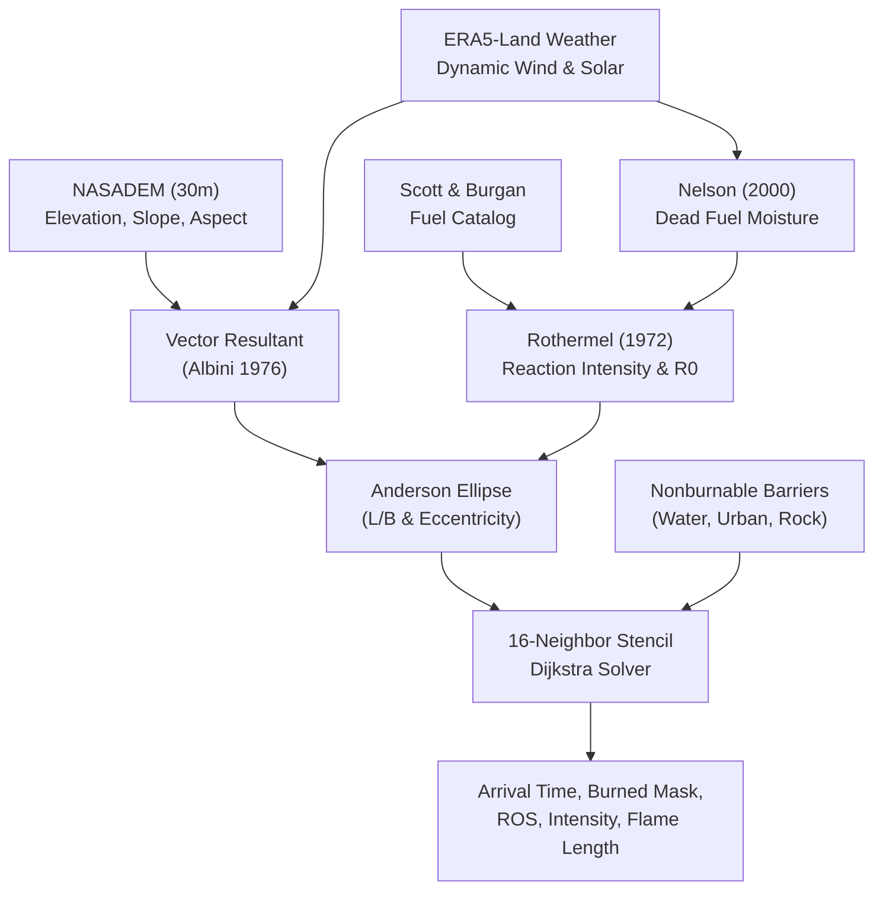

# Q-NYX Fire — INFONOR 2026 Reproducibility Package

[](https://www.python.org/)
[](LICENSE)
[-brightgreen.svg)](docs/REPRODUCIBILITY.md)
[](https://infonor2026.cl/)

Official open-access code and artifact reproducibility repository for the research article:  
**"Q-NYX Fire: Deterministic Wildfire Propagation Engine, Historical Validation, and Controlled Benchmark Against FlamMap"**  
*XVII Congreso Internacional de Computación e Informática del Norte de Chile (INFONOR 2026).*

---

## 1. Executive Summary & Scientific Scope

This repository provides an autonomous, self-contained, and audited software package to inspect, verify, and reproduce the computational experiments and numerical tables published in the INFONOR 2026 paper.

### What is Included:
- **Core Scientific Engine (`src/fire_engine`)**: Pure Python/NumPy implementation of Rothermel (1972) surface rate of spread, Albini (1976) / Anderson (1983) vector-elliptical directional combination, Nelson (2000) dead fuel moisture radial diffusion solver, Scott & Burgan 40-fuel catalog, dynamic weather series interpolation, and 16-neighbor stencil Dijkstra arrival-time propagation.
- **Talamí 2017 Frozen Run (`QNYX-FIRE-TALAMI-001`)**: Full 12-hour simulation over the 56,563 ha historical domain at 30m resolution.
- **CONAF Spatial Validation (`QNYX-VAL-TALAMI-001`)**: Comparison against the official CONAF historical fire perimeter.
- **Controlled External Benchmark (`QNYX-BENCH-006`)**: 8-case wind-slope coupled interaction matrix comparing Q-NYX Dijkstra vs USDA Forest Service FlamMap 6.2 Minimum Travel Time (MTT).
- **Automated Verification Suite (`scripts/reproduce_all.py` & `tests/`)**: 136 unit and integration tests certifying 100% invariant satisfaction and hash equality.

### What is Excluded:
- **Zero Commercial / Proprietary Modules**: No frontend, web UI, FastAPI endpoints, operational cloud services, or authentication logic.
- **Zero Secrets & Personal Paths**: Sanitized relative paths, zero `.env` files, API keys, or machine-specific routes.
- **Zero Untested Code**: No experimental quantum stubs or unvalidated research branches.

---

## 2. Scientific Core Architecture



---

## 3. Quickstart & One-Command Reproduction

### Step 3.1: Environment Setup
```bash
# Clone the repository
git clone https://github.com/qnyx-fire/qnyx-fire-infonor-2026-reproducibility.git
cd qnyx-fire-infonor-2026-reproducibility

# Create an isolated environment (Python >= 3.8)
python -m venv .venv
source .venv/bin/activate  # On Windows: .\.venv\Scripts\Activate.ps1

# Install dependencies
pip install -r requirements.txt
```

### Step 3.2: Run Fast Smoke Test (< 2 seconds)
Verifies physical kernel functions, elliptical eccentricity, and Nelson moisture solver:
```bash
pytest tests/test_smoke.py -v
```

### Step 3.3: One-Command Master Audit (Recommended)
Audits external dataset integrity, checks all frozen SHA-256 hashes, evaluates validation metrics, and summarizes the paper results:
```bash
python scripts/reproduce_all.py
```

---

## 4. Key Experimental Results Reported in Paper

### Experiment 1: Talamí 2017 Integration (`QNYX-FIRE-TALAMI-001`)
- **Domain**: 640 rows × 982 columns (56,563.20 ha, 30m resolution, EPSG:32719).
- **12-Hour Burned Area**: **1,313.01 ha** (14,589 cells, 2.32% domain coverage).
- **Execution Performance**: 3.05 s spread solver runtime, 117,520 directional arc calculations.
- **Spread Statistics**: Mean ROS: $3.27\ \text{m/min}$, 95th Percentile: $9.53\ \text{m/min}$, Max ROS: $23.79\ \text{m/min}$.
- **Fireline Intensity**: Mean: $1,940.57\ \text{kW/m}$, Max: $9,373.27\ \text{kW/m}$.
- **Invariants**: 10/10 numerical invariants satisfied (`ros_cap_hit_count = 0`, zero nonburnable burned cells).

### Experiment 2: Validation Against CONAF Envelope (`QNYX-VAL-TALAMI-001`)
- **CONAF Raster Reference Area**: **8,006.22 ha** (88,958 cells rasterized at 30m).
- **True Positive Overlap**: **382.50 ha** (4,250 cells).
- **Primary Spatial Metrics**: $\text{IoU} = 0.0428$, $\text{Dice} = 0.0821$.
- **Centroid Distance Shift**: $4,551.97\ \text{m}$ (Bearing 41.62° Northeast).
- **Scientific Guard**: CONAF records a 26-day multi-day containment perimeter (Jan 14 – Feb 9, 2017). It serves as a final envelope reference, not temporal 12-hour ground truth.

### Experiment 3: Benchmark Against FlamMap 6.2 MTT (`QNYX-BENCH-006`)
Spatial comparison under coupled wind and slope on homogeneous FM1 fuel at 180 minutes:

| Case | Scenario Role | Wind / Slope Vector | Q-NYX Area (ha) | FlamMap Area (ha) | IoU | Sorensen-Dice |
| :---: | :--- | :--- | :---: | :---: | :---: | :---: |
| **01** | `CONTROL_FLAT_CALM` | Calm, 0° slope | 14.49 | 18.00 | **0.805** | **0.892** |
| **02** | `CONTROL_PURE_WIND` | Wind East, 0° slope | 61.02 | 79.56 | **0.767** | **0.868** |
| **03** | `CONTROL_PURE_SLOPE` | Calm, Slope East 10° | 28.44 | 37.98 | **0.749** | **0.856** |
| **04** | `WIND_SLOPE_ALIGNED` | Wind East, Slope East (0° sep) | 101.34 | 106.92 | **0.936** | **0.967** |
| **05** | `WIND_SLOPE_OBLIQUE_45` | Wind East, Slope NE (45° sep) | 92.88 | 100.35 | **0.924** | **0.960** |
| **06** | `WIND_SLOPE_CROSS_90` | Wind East, Slope North (90° sep) | 69.57 | 82.80 | **0.840** | **0.913** |
| **07** | `WIND_SLOPE_OBLIQUE_135` | Wind East, Slope SW (135° sep) | 42.84 | 61.02 | **0.702** | **0.825** |
| **08** | `WIND_SLOPE_OPPOSED_180` | Wind East, Slope West (180° sep) | 29.79 | 51.66 | **0.574** | **0.729** |

---

## 5. Repository Layout

```
qnyx-fire-infonor-2026-reproducibility/
├── README.md                      # Overview, scope, quickstart, paper results
├── LICENSE                        # MIT License + Third-party attribution notices
├── CITATION.cff                   # Citation file format (INFONOR 2026)
├── requirements.txt               # Pinned dependencies with verified baseline
├── pyproject.toml                 # Packaging metadata & pytest config
├── .gitignore                     # Git ignore rules
│
├── src/fire_engine/               # Core scientific engine
│   ├── config.py                  # Global simulation engine config
│   ├── domain.py                  # Raster domain and grid geometry
│   ├── units.py                   # Physical units conversion
│   ├── weather.py                 # Dynamic weather manager & solar flux
│   ├── barriers.py                # Nonburnable cell masking
│   ├── raster_loader.py           # Raster loading utilities
│   ├── schemas.py                 # Pydantic data schemas
│   ├── simulation.py              # Simulation coordinator
│   ├── spread.py                  # 16-neighbor stencil Dijkstra arrival-time solver
│   ├── validation.py              # Spatial validation metrics (IoU, Dice, centroids)
│   ├── directional/               # Vector combination & elliptical spread
│   │   ├── ellipse.py             # Anderson (1983) ellipse geometry
│   │   ├── resultant.py           # Albini (1976) wind+slope vector resultant
│   │   └── spread.py              # Directional Rothermel spread
│   ├── fuels/                     # Fuel modeling & moisture physics
│   │   ├── models.py              # Scott & Burgan 40-model catalog
│   │   ├── moisture.py            # Dynamic fuel moisture transfers
│   │   ├── nelson.py              # Nelson (2000) physical dead fuel moisture solver
│   │   └── radial_diffusion.py    # Radial diffusion cylindrical PDE solver
│   └── kernels/                   # Surface fire physical kernels
│       ├── base.py                # Base kernel interface
│       └── rothermel.py           # Rothermel (1972) rate-of-spread equations
│
├── configs/                       # Official simulation configurations
│   ├── engine.json                # Engine default thresholds
│   ├── barriers.json              # Barrier land-cover mappings
│   ├── fuel_parameters.json       # General fuel physical parameters
│   ├── fuel_models_scott_burgan_qnyx.json  # Scott & Burgan standard parameters
│   └── scenarios/
│       └── talami_2017.yaml       # Canonical Talamí 2017 scenario specification
│
├── scripts/                       # Reproducibility runners
│   ├── reproduce_all.py           # Master one-command reproduction script
│   ├── run_talami_simulation.py   # Talamí 2017 12-hour simulation runner
│   ├── validate_talami_conaf.py   # CONAF perimeter validation evaluator
│   ├── run_bench_006_flammap.py   # BENCH-006 8-case spatial runner
│   ├── compare_bench_006.py       # Q-NYX vs FlamMap MTT comparison generator
│   └── download_external_data.py  # External data acquisition & integrity checker
│
├── benchmarks/                    # Benchmark inputs, scenarios, and reference outputs
│   ├── historical_talami_2017/    # Historical Talamí domain inputs & outputs
│   └── qnyx_bench_006_flammap_wind_slope/ # BENCH-006 FlamMap comparison package
│
├── manifests/                     # Official cryptographic manifests
│   ├── QNYX_FIRE_TALAMI_001_RELEASE_MANIFEST.json
│   ├── QNYX_VAL_TALAMI_001_RELEASE_MANIFEST.json
│   ├── BENCH_006_MANIFEST.json
│   └── sha256_checksums.txt       # SHA-256 hashes of all frozen artifacts
│
├── results/                       # Paper numerical tables in CSV & JSON
│   ├── talami_2017/               # Hourly diagnostics and validation metrics
│   └── bench_006/                 # Spatial comparison, arrival errors, audit tables
│
├── tests/                         # Comprehensive automated test suite (136 tests)
│   ├── conftest.py
│   ├── test_smoke.py              # Fast (<2s) smoke test
│   ├── test_rothermel.py          # Rothermel physics invariant unit tests
│   ├── test_directional.py        # Vector resultant and ellipse tests
│   ├── test_nelson_moisture.py    # Nelson physical model unit tests
│   ├── test_talami_reproducibility.py # Talamí integration and CONAF validation tests
│   └── test_bench_006.py          # BENCH-006 spatial comparison contract tests
│
└── docs/                          # In-depth technical documentation
    ├── DATA.md                    # Data provenance, licensing, and acquisition
    ├── REPRODUCIBILITY.md         # Detailed reproduction instructions & audit protocol
    └── ARCHITECTURE.md            # Mathematical formulation and governing equations
```

---

## 6. Known Scientific Limitations

1. **`TIME_DEPENDENT_REACTIVATION_LIMITATION`**:  
   Dijkstra's minimum arrival time algorithm permanently closes nodes once removed from the priority queue. Under shifting wind fields, previously burned cells cannot reactivate to push advancing firelines in opposite directions.
2. **Ignition Time Scenario Hypothesis**:  
   Official CONAF incident records do not record exact minute-level historical ignition timestamps. Start times in simulations ($t_0 = \text{2017-01-14 18:00 UTC}$) represent exploratory scenario hypotheses, not confirmed historical truth.

---

## 7. License & Citation

- **Code License**: [MIT License](LICENSE).
- **Data Attributions**: NASA NASADEM (Public Domain), Copernicus Climate Change Service (CC-BY 4.0), CONAF Chile (Public Sector Open Data), USDA Forest Service (Public Domain).
- **Citation**: See [`CITATION.cff`](CITATION.cff).
